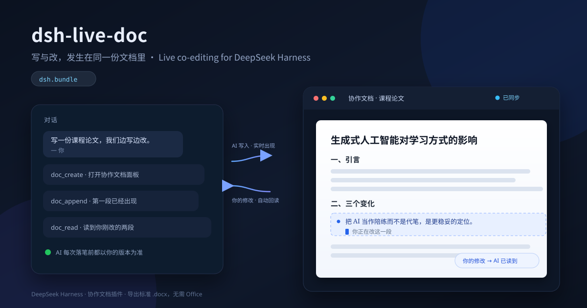

# dsh-live-doc

**Live co-editing for DeepSeek Harness.** The agent writes, you edit the same document in a real-time panel, and the agent reads your edits before it writes again — no "finish the whole thing, then paste my version back into the chat" round trip.

[](LICENSE)
[](https://github.com/deepseek-ai/deepseek-harness)
[](package.json)

> 中文文档：[README.zh-CN.md](README.zh-CN.md)

<p align="center"></p>

## Why

Long documents are painful to generate in one shot: the model writes 5,000 words, you read them, you change three paragraphs, and then you have to explain every change back. This plugin flips that around.

- The document lives in a panel beside the chat.
- Every tool call appears in the panel immediately.
- Any paragraph can be edited by you while the agent is still working.
- The next `doc_read` returns your version plus a list of what you changed.

## Features

- **A free-floating sidebar** — drag the header to move the panel, resize it from any edge or corner, and it snaps flush to a screen edge (snap it right and it reads as a right sidebar). Maximize/restore, remembered geometry per browser, double-click the header to reset.
- **Left sidebar workspace** — a global **Live document** row in the left sidebar opens a full-page document workspace at any time, even without a chat session. The floating panel and header button remain for editing beside the conversation.
- **Block-level co-editing** — headings 1–3, paragraphs, bullet and numbered lists, quotes, code, dividers; bold / italic / underline; Enter creates the next paragraph, Backspace on an empty one deletes it.
- **One shared document** — agent tools and the browser panel read and write the same block list; the browser saves with a per-block base revision, so an agent write and your edit never silently overwrite each other.
- **Edit journal** — `doc_read` reports “the user changed N paragraphs after your last read” with before/after snippets, and tells the model to follow your version.
- **Safe rewrites** — `doc_replace` takes an `expect` prefix and refuses to touch a paragraph whose text moved; the agent must re-read first.
- **Dependency-free DOCX export** — a small OOXML writer produces a real `.docx` (A4, 宋体 body, 1.5 line spacing, Word heading styles, real bullet/number lists) with no Office installation, no `python-docx`, and no build step. Markdown export is available too.
- **Survives restarts** — one JSON file per document under `$DSH_HOME/live-doc/`; the panel reopens the document you were working on.
- **No telemetry, no network** — the plugin only talks to the DSH host it is loaded into.

## Requirements

- DeepSeek Harness `>= 0.2.1-rc.2 < 0.3.0` (verified on the Desktop profile of `0.2.2-rc.3`).
- Node.js `>= 22.19.0` (the DOCX writer uses `node:zlib`'s `crc32`).
- No other runtime dependency. The browser half uses the host's React module table.

## Install

### DeepSeek Harness Desktop

**Plugins → Add plugin** and enter `dsh-live-doc`. After installation, reload the page once (`Cmd+R` / `Ctrl+R`) so the browser half is registered.

### CLI

```bash
dsh plugin --profile web add dsh-live-doc
# or straight from GitHub:
dsh plugin --profile web add github:jiayiliust-ops/dsh-live-doc
```

Restart DSH if the plugin manager reports a restart requirement.

### From a local checkout

```bash
npm pack                       # produces dsh-live-doc-1.0.0.tgz
dsh plugin --profile web add file:/absolute/path/dsh-live-doc-1.0.0.tgz
```

Installing a tarball is the most durable option: the profile keeps its own copy, so moving or deleting the checkout later does not break the plugin.

## Quick start

1. Ask for a document and the co-editing workflow, for example:

   > 写一份课程论文，题目是……，我们边写边改。

2. The agent calls `doc_create`; the **协作文档 / Live document** panel opens on the right. You can also open the full-page workspace from the **Live document** row in the left sidebar, or the button in the session header.
3. The agent calls `doc_append` one to three paragraphs at a time. Edit anything you like in the panel while it works.
4. When the agent continues, it calls `doc_read` first, sees your edits, and follows them.
5. Ask for the export; `doc_export` writes `<workspace>/<title>.docx`. The panel stays open, and exporting again overwrites the same file.

The panel's own **导出 DOCX** button flushes unsaved keystrokes first and then exports.

## Tools

| Tool | Purpose | Required |
| --- | --- | --- |
| `doc_create` | Create a document and open the panel; optional export path | `title` |
| `doc_append` | Append Markdown paragraphs (headings, lists, quotes, fenced code) | `markdown` |
| `doc_insert` | Insert after a paragraph id, or at `end` | `after`, `markdown` |
| `doc_replace` | Rewrite one paragraph, guarded by an `expect` prefix | `blockId`, `markdown` |
| `doc_delete` | Delete one paragraph | `blockId` |
| `doc_read` | Read the current Markdown and the pending user edits | – |
| `doc_export` | Export `.docx` or `.md` | – |
| `doc_list` | List all live documents | – |

All tools accept an optional `docId`; without it they use the panel's active document.

## How it works

A document is a flat list of blocks:

```json
{ "id": "b_...", "type": "p", "html": "正文 <strong>加粗</strong>", "rev": 7, "by": "user", "ts": 1794... }
```

- The host keeps one `DocumentStore` per profile, persisted atomically as `~/.dsh/live-doc/<docId>.json`.
- The browser polls `POST /live-doc/api/state` every 900 ms and renders the block list.
- Your edits go back through `POST /live-doc/api/patch` with the block's `baseRev`. If the block changed since the browser last read it **and** the agent wrote it, the host keeps your text, marks the edit as a conflict, and tells the model on its next read.
- `doc_read` drains the pending-edit journal and returns your before/after snippet. The agent's own `doc_replace` clears that block's journal entries, so a finished rewrite does not keep reporting stale edits.
- The route accepts only same-origin requests carrying `x-live-doc: 1`; it is served behind DSH's normal browser authentication.

See [docs/ARCHITECTURE.md](docs/ARCHITECTURE.md) for the block model, the RPC surface, and the export pipeline.

## DOCX output

The exporter builds the whole package itself (`[Content_Types].xml`, relationships, `document.xml`, `styles.xml`, `numbering.xml`, `settings.xml`, core properties) and zips it with `node:zlib`. Output is a standard Word file:

- A4 page size, 2.54 cm margins
- 宋体 / Times New Roman body at 12 pt, 1.5 line spacing
- Heading 1–3 and Quote as real Word styles
- bullet and decimal numbering through `numbering.xml`
- inline bold, italic, underline, strike, code, and hyperlinks
- fenced code as a shaded monospace style

## Data and privacy

- Documents live in `$DSH_HOME/live-doc/` (default `~/.dsh/live-doc/`), one JSON file per document. Set `DSH_LIVE_DOC_DIR` to move the directory.
- Exports are written only when you or the agent asks; the plugin never scans your disk for `.docx` files.
- No network calls, no telemetry, no credentials.

## Limitations

- Text, images and tables are modeled. Footnotes, page numbers, headers/footers, a table of contents field, pagination and fine typography are not; finish those in Word.
- Images are copies: deleting a block does not immediately delete the file under `assets/<docId>/`, so the cache needs a manual clean-up once in a while.
- Remote images render only; they are never downloaded, so they do not appear in the exported .docx.
- Existing `.docx` files are not imported. The plugin owns documents it creates.
- The panel follows the profile's active document; several sessions editing different documents at once share one active id.
- DOCX export uses conservative defaults; fine layout still belongs in Word.
- After updating the plugin, reload the browser page once.

## Development

There is no build step — plain ESM on the host and a plain browser module on the client.

```bash
npm test          # node:test suite: store, DOCX package, tool compiler, manifest
node --check src/host/index.js
node --check src/client/index.js
```

To iterate against a running install, use a local checkout and re-enable the plugin row after host changes (Node caches imported ESM modules; a full DSH restart is the reliable path). See [CONTRIBUTING.md](CONTRIBUTING.md).

## License

MIT © dsh-live-doc contributors
