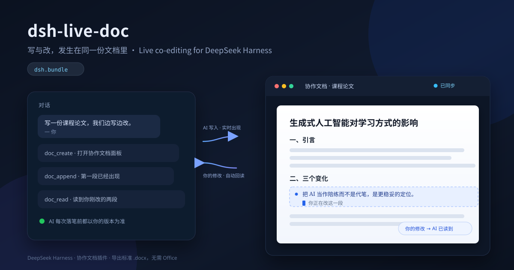

# dsh-live-doc · 协作文档

**DeepSeek Harness 的实时协作文档插件。** AI 在写，你在改，改的是同一份文档；下一次 AI 动笔之前会先读到你改过的版本——不用等它写完、不用另存 Word、也不用把改动重新贴回对话。

[](LICENSE)
[](https://github.com/deepseek-ai/deepseek-harness)
[](package.json)

> English documentation: [README.md](README.md)

<p align="center"></p>

## 为什么做这个

长文档一次性生成很难用：模型哗哗写完 5000 字，你读一遍、改三段，然后还得把每一处改动解释回去。这个插件把顺序倒过来：

- 文档在对话旁边的面板里，`doc_append` 一返回就能看到；
- AI 还在往下写的时候，你就能改任意一段；
- 下一次 `doc_read` 会带着「你改过哪几段」的改前/改后，AI 顺着你的版本写。

## 功能

- **自由侧栏**：顶部拖动即可移动，八向边缘/角可缩放，靠近屏幕边缘自动贴边（贴右边就是右栏），有放大/还原按钮，位置与大小按浏览器记住；双击标题栏复位
- **顶部只留文档标题行**：打开文档后插件自己那行标题栏不再占位——新建/分栏/紧凑并进文档标题行，浮窗模式下这行就是拖动把手（双击复位），放大/收起排在行尾；空面板和分栏时才回到独立标题栏。标签栏和格式工具栏都是整块收起（不裁切、不留空，腾出的高度立刻给正文）；目录与正文页宽按比例保存，隐藏目录或拉伸窗口时正文自动撑开
- **左侧常驻入口**：左侧栏新增「协作文档」应用行，随时打开整页文档工作区，不需要先有对话；右侧浮层面板与标题栏按钮保留，用于边聊边改
- **段落级协作编辑**：标题 1–3、正文、项目符号、编号、引用、代码、分隔线；加粗/斜体/下划线；Enter 新建下一段，空段 Backspace 删除
- **图片**：面板里粘贴、拖入或选择图片，或让 AI 写 ``，文件会复制进文档资源目录并在导出的 .docx 里内嵌；图片可改图注与 25/50/75/100% 显示宽度（远程 http(s) 图片只显示、不下载）
- **表格**：AI 写标准 GFM 表格即变成可编辑表格——表头、增删行列、自动保存；导出时是真正的 Word 表格（跨页时表头重复）
- **多文档页签与分栏**：同时打开多份文档，可并排分栏对照；分栏里的第二份文档不会抢走宿主的活动文档
- **浮动目录**：按标题 1–3 生成大纲，滚动高亮，点击跳段（少于两条标题时自动隐藏）
- **同一份文档**：Agent 工具和浏览器面板读写同一个块列表；浏览器保存时带每段的 `baseRev`，两边同时改也不会静默覆盖
- **编辑日志**：`doc_read` 会报告「用户在你上次读取后改了 N 段」并给出改前/改后，提示模型以用户版本为准
- **防错位改写**：`doc_replace` 必须带 `expect` 前缀，段落文字对不上就拒绝，要求先重新读
- **零依赖 DOCX 导出**：自带 OOXML 写入器，生成真正的 `.docx`（A4、宋体正文、1.5 倍行距、Word 标题大纲、真项目符号/编号），不需要 Office、`python-docx` 或构建步骤；也支持 `.md`
- **重启不丢**：每份文档一个 JSON 文件，存在 `$DSH_HOME/live-doc/`；面板会重新打开你上次在改的那份
- **无遥测、不联网**：插件只和加载它的 DSH 宿主通信

## 要求

- DeepSeek Harness `>= 0.2.1-rc.2 < 0.3.0`（在 `0.2.2-rc.3` 的 Desktop profile 上验证）
- Node.js `>= 22.19.0`（DOCX 写入器用到 `node:zlib` 的 `crc32`）
- 没有其他运行时依赖；浏览器半边用宿主提供的 React 模块

## 安装

### DSH 桌面版

**插件 → 添加插件**，输入 `dsh-live-doc`。装完刷新一次页面（`Cmd+R` / `Ctrl+R`），让浏览器半边注册。

### 命令行

```bash
dsh plugin --profile web add dsh-live-doc
# 或者直接从 GitHub 安装：
dsh plugin --profile web add github:jiayiliust-ops/dsh-live-doc
```

如果插件管理器提示需要重启，就重启 DSH。

### 从本地目录

```bash
npm pack                       # 生成 dsh-live-doc-1.0.0.tgz
dsh plugin --profile web add file:/绝对路径/dsh-live-doc-1.0.0.tgz
```

这是最「抗折腾」的装法：profile 里保存自己的一份副本，之后移动或删除源码目录都不会影响插件。

## 快速开始

1. 这样提需求：

   > 写一份课程论文，题目是……，我们边写边改。

2. Agent 调 `doc_create`，右侧「协作文档」面板自动打开；也可以从左侧栏的「协作文档」打开整页工作区，或点会话标题栏的「协作文档」按钮。
3. Agent 每次 `doc_append` 写 1–3 段，你随时在面板里改。
4. Agent 继续写之前会先 `doc_read`，看到你的修改并顺着写。
5. 要成品时说一声，`doc_export` 导出 `<工作区>/<标题>.docx`；面板不关，再导出覆盖同一个文件。

面板上的「导出 DOCX」按钮会先等未保存的按键落盘，再导出。

## 工具

| 工具 | 作用 | 必填 |
| --- | --- | --- |
| `doc_create` | 新建文档并打开面板，可指定导出路径 | `title` |
| `doc_append` | 追加 Markdown 段落（标题/列表/引用/代码块） | `markdown` |
| `doc_insert` | 在某段之后插入，`after: "end"` 表示文末 | `after`、`markdown` |
| `doc_replace` | 重写一段，`expect` 防错位 | `blockId`、`markdown` |
| `doc_delete` | 删除一段 | `blockId` |
| `doc_read` | 读当前 Markdown + 未读的用户修改 | – |
| `doc_export` | 导出 `.docx` 或 `.md` | – |
| `doc_list` | 列出所有协作文档 | – |

所有工具都可以带 `docId`；不带就用面板当前打开的文档。

## 实现

一份文档是一个扁平的块列表：

```json
{ "id": "b_...", "type": "p", "html": "正文 <strong>加粗</strong>", "rev": 7, "by": "user", "ts": 1794... }
```

- 宿主为每个 profile 维护一个 `DocumentStore`，用原子写落到 `~/.dsh/live-doc/<docId>.json`
- 浏览器每 900 ms 轮询 `POST /live-doc/api/state`，渲染块列表
- 你的编辑通过 `POST /live-doc/api/patch` 回传，带这一段的 `baseRev`；如果这段在你读取后被 AI 改过，宿主保留你的文字、标记 `conflict`，并在模型下次读取时告知
- `doc_read` 取走待读编辑日志并返回改前/改后；Agent 自己 `doc_replace` 会清掉这一段的日志，避免改完后还反复报告旧改动
- 路由只接受同源、带 `x-live-doc: 1` 头的请求，并且位于 DSH 正常的浏览器认证之后

块模型、RPC 面、导出流水线详见 [docs/ARCHITECTURE.md](docs/ARCHITECTURE.md)。

## DOCX 输出

导出器自己拼整个包（`[Content_Types].xml`、关系、`document.xml`、`styles.xml`、`numbering.xml`、`settings.xml`、文档属性），再用 `node:zlib` 打成 zip。产物是标准 Word 文件：

- A4 纸张、2.54 cm 页边距
- 宋体 / Times New Roman 正文 12 pt、1.5 倍行距
- 标题 1–3 与引用是真正的 Word 样式
- 项目符号、编号走 `numbering.xml`
- 行内加粗、斜体、下划线、删除线、代码、超链接
- 围栏代码块是带底纹的等宽样式

## 数据与隐私

- 文档在 `$DSH_HOME/live-doc/`（默认 `~/.dsh/live-doc/`），一份文档一个 JSON；可用 `DSH_LIVE_DOC_DIR` 改目录
- 只有你或 Agent 明确要求时才导出；插件不会扫描磁盘上的 `.docx`
- 不联网、无遥测、不碰凭据

## 已知边界

- 已建模文本、图片与表格；脚注、页码、页眉页脚、目录域、分页与精细排版仍未建模，交给 Word 完成
- 图片存的是副本：删除文档块不会立刻删掉 `assets/<docId>/` 里的文件，缓存有上限，手动清理即可
- 远程图片只渲染不下载，因此不会出现在导出的 .docx 里
- 不导入已有的 `.docx`；插件只管自己创建的文档
- 主面板跟随 profile 的「当前活跃文档」；分栏里的第二份文档是只读活动 id 的（不会抢宿主的活动文档）
- DOCX 使用保守默认版式，精细排版仍在 Word 里做
- 更新插件后需要刷新一次页面

## 开发

没有构建步骤：宿主是普通 ESM，客户端是普通浏览器模块。

```bash
npm test          # node:test：store、DOCX 包、工具编译器、清单
node --check src/host/index.js
node --check src/client/index.js
```

对着运行中的实例迭代时，用本地目录安装，改完宿主代码后重新启用插件那一行；Node 会缓存已导入的 ESM 模块，最稳的是重启 DSH。见 [CONTRIBUTING.md](CONTRIBUTING.md)。

## 许可证

MIT © dsh-live-doc contributors
